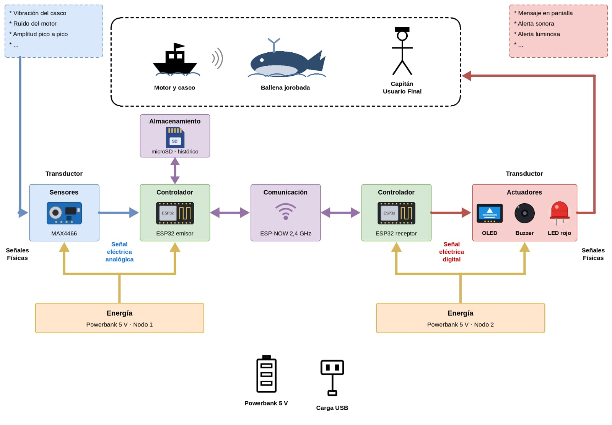

# 🎛️ Sistema Embarcado de Monitoreo Acústico-Vibracional

> **Prototipo de sistema embarcado para el monitoreo acústico-vibracional y alerta preventiva en tiempo real.**

---

## 📋 Descripción del Proyecto

Este repositorio contiene el desarrollo técnico, esquemáticos electrónicos y documentación del prototipo diseñado para detectar anomalías acústicas y de vibración en motores, generando alertas tempranas que previenen fallas mecánicas.

### 📂 Contenido del Repositorio
Todos los archivos fuente se encuentran organizados dentro de la carpeta **[`proyecto/`](./proyecto)**:
* 📄 **Documentación:** Definición de requerimientos y modelo Canvas (`Definicion de requerimientos y modelo canvas.pdf`).
* 🛠️ **Diseño Electrónico (KiCad):** Archivos de esquemático (`.kicad_sch`), placa PCB (`.kicad_pcb`) y librerías del prototipo 1.
* 🖼️ **Diagramas:** Esquema general de bloques y arquitectura del sistema.

---

## 📊 Diagrama del Sistema

---

## 👥 Equipo de Trabajo

| Integrante | Rol / Programa |
| :--- | :--- |
| **Samuel Gabriel Medina Arciniegas** | Ingeniería Electrónica |
| **Mateo Ruiz Palencia** | Ingeniería Electrónica |
| **Juan David Martínez Padilla** | Ingeniería Electrónica |
| **Yised Viviana Bellaizan Valencia** | Ingeniería Electrónica |

---

## 🎓 Información Académica

* **Asignaturas:** Taller de Ingeniería Electrónica — Introducción a la Ingeniería Electrónica.
* **Fase actual:** Prototipo 1 (Esquemático y definición de requerimientos).

